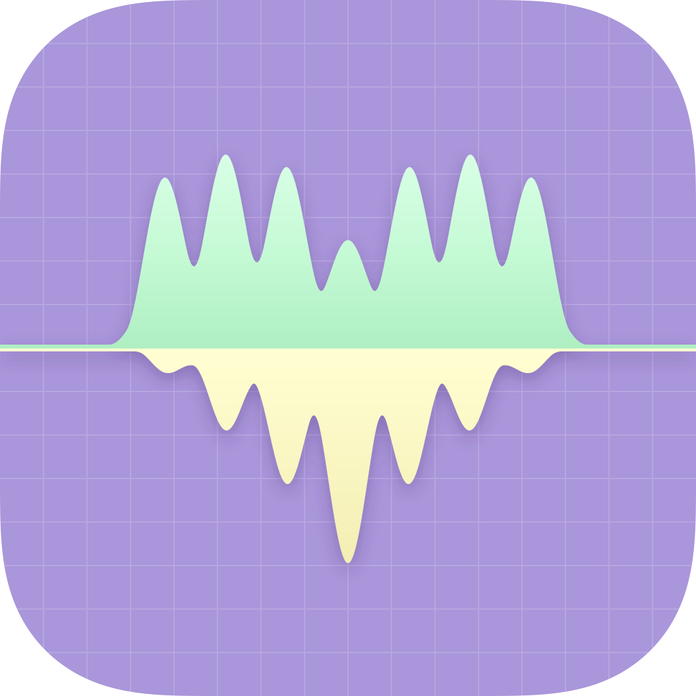

<a id="english"></a>

<p align="center">
  
</p>

# SysVitals

SysVitals is a lightweight CPU / memory / network monitor for the Windows taskbar and macOS menu bar. It shows live percentages and transfer rates, follows system font, DPI, and light/dark appearance, and opens a CPU / memory history chart when clicked.

The status bar is thin native code; settings and history run as separate GPUI processes, keeping the resident indicator small — about 9 MB on Windows 11 and 18 MB on macOS (Apple Silicon), release build with default settings. It runs on Windows 10 2004+ / 11 (x64, arm64) and macOS 13+ (Apple Silicon, Intel).

English | [中文](#chinese)

## Install

**Windows** — Download `SysVitals_Windows_<arch>_v<version>_setup.exe` from [Releases](https://github.com/fynhq/sysvitals/releases) and run it. Setup installs per-user under `%LOCALAPPDATA%\Programs\SysVitals` and needs no administrator rights. The portable `..._portable.zip` extracts to one `SysVitals/` folder with three executables; run `SysVitals.exe` and keep all three together. The build is unsigned: if SmartScreen appears, choose **More info → Run anyway**.

**macOS** — Download the dmg, drag `SysVitals.app` to `/Applications` (or `~/Applications`), and launch the app, not the binaries inside `Contents/MacOS`. The build is ad-hoc signed without notarization; if macOS blocks it, remove the quarantine flag:

```sh
xattr -d -r com.apple.quarantine /Applications/SysVitals.app
```

Use your actual path when installed in `~/Applications`; add `sudo` on permission errors. SysVitals runs in the menu bar with no Dock icon (Settings may show one while open).

**Upgrade and uninstall** — Settings, history, and logs live in `%APPDATA%\SysVitals` on Windows and `~/Library/Application Support/SysVitals` on macOS, and are kept across upgrades. There is no auto-update: run the new Windows setup over the existing install (or replace the portable folder), or replace the macOS app and run the quarantine command again. To uninstall, use Settings → Apps on Windows (or delete the portable folder) and move the app to the Trash on macOS; delete the data folder too to erase settings, history, and logs. On macOS, turn off Launch at login first.

## Usage

- Click the indicator to open the CPU / memory history chart; click again, click away, or press Esc to close.
- Right-click for Task Manager (Windows) or Activity Monitor (macOS), Settings, Restart, and Quit.
- Settings save immediately. Configure language, sampling interval (1/2/3 s; default 2 s), layout, spacing, prefixes, indicator theme, and Windows taskbar anchor/margin; vertical taskbars are supported.
- Settings and history follow system appearance and accent color; the Windows indicator theme can be auto, light, or dark.
- Launch at login is off by default; on macOS the first enable may need approval in **System Settings → General → Login Items & Extensions**.
- History ranges are 5 minutes, 1 hour, 1 day, and 1 month; data is retained for up to one month, and logs older than 7 days are removed. The copy button exports the visible range as TSV with a UTF-8 BOM; network rates are live-only. History retention and copy scope are advanced `config.toml` settings (`history.*`), not settings-window controls.
- On Windows, each visible taskbar gets its own indicator; enable "Show my taskbar on all displays" to show it on secondary screens.
- All data stays local; there is no telemetry, cloud service, or account.

## Build from source

Requires a stable Rust toolchain (MSVC on Windows, Xcode command-line tools on macOS). `cargo build` and `cargo test` cover the cross-platform core:

```sh
cargo build
cargo test
cargo run -p sysvitals-core --example monitor
```

Official packages are built by CI. To build a platform crate on its native OS:

```sh
cargo build -p app-win
cargo build -p app-mac
cargo build -p app-settings
cargo build -p app-history
```

## License

Released under the MIT License. See [LICENSE](LICENSE).

---

<a id="chinese"></a>

# SysVitals

SysVitals 是常驻 Windows 任务栏 / macOS 菜单栏的轻量 CPU、内存、网速监控：实时显示占用百分比与上下行速度，字号、DPI 与亮暗跟随系统，点击即可查看 CPU / 内存历史走势图。

状态栏由轻量原生代码绘制，设置与走势图为独立 GPUI 进程，常驻指示器约 9 MB（Windows 11）/ 18 MB（macOS Apple Silicon）。支持 Windows 10 2004+ / 11（x64 / arm64）与 macOS 13+（Apple Silicon / Intel）。

[English](#english) | 中文

## 安装

**Windows** — 从 [Releases 页面](https://github.com/fynhq/sysvitals/releases) 下载 `SysVitals_Windows_<arch>_v<version>_setup.exe` 并运行。安装器按当前用户安装到 `%LOCALAPPDATA%\Programs\SysVitals`，无需管理员权限。便携版 `..._portable.zip` 解压后为单一 `SysVitals/` 目录，含三个 exe；运行 `SysVitals.exe`，三个文件请保持在一起。构建未签名；如出现 SmartScreen，选择“更多信息”→“仍要运行”。

**macOS** — 下载 dmg，把 `SysVitals.app` 拖到 `/Applications`（或 `~/Applications`），启动 `.app`，不要直接运行 `Contents/MacOS` 内的二进制。构建只有 ad-hoc 签名、未公证；如被系统拦截，移除隔离标记：

```sh
xattr -d -r com.apple.quarantine /Applications/SysVitals.app
```

装在 `~/Applications` 时请替换路径；权限不足可在命令前加 `sudo`。SysVitals 常驻菜单栏，无 Dock 图标（设置窗打开时可能显示）。

**升级与卸载** — 设置、历史与日志保存在 `%APPDATA%\SysVitals`（Windows）或 `~/Library/Application Support/SysVitals`（macOS），升级后保留。没有自动更新：Windows 运行新的 setup 覆盖安装（便携版替换目录），macOS 替换 app 后需重新执行隔离命令。卸载时，Windows 在“设置 → 应用”中卸载（便携版直接删除目录），macOS 把 app 移到废纸篓；如需清除设置、历史与日志，再删除数据目录。macOS 请先关闭开机自启。

## 使用

- 单击指示器打开 CPU / 内存走势图；再次单击、点击别处或按 Esc 关闭。
- 右键菜单：任务管理器（Windows）/ 活动监视器（macOS）、设置、重启、退出。
- 设置即时保存。可配置语言、采样间隔（1/2/3 秒，默认 2 秒）、布局、间距、前缀、指示器主题、Windows 任务栏锚位/边距；支持垂直任务栏。
- 设置与走势图跟随系统亮暗与强调色；Windows 指示器主题可选自动/亮色/暗色。
- 开机自启默认关闭；macOS 首次开启可能需要在“系统设置 → 通用 → 登录项与扩展”中允许。
- 走势图范围：5 分钟、1 小时、1 天、1 个月，历史最多保留一个月，日志超过 7 天自动清理。复制按钮导出当前可视范围为 TSV（UTF-8 BOM）；网速只实时显示。历史保留天数与复制范围是 `config.toml` 的高级配置（`history.*`），设置窗不提供入口。
- Windows 上每个可见任务栏都有独立指示器；开启“在所有显示器上显示任务栏”后副屏才会出现。
- 所有数据都在本地；无遥测、云服务或账号。

## 从源码构建

要求 stable Rust 工具链（Windows 用 MSVC，macOS 用 Xcode 命令行工具）。`cargo build` 与 `cargo test` 覆盖跨平台 core：

```sh
cargo build
cargo test
cargo run -p sysvitals-core --example monitor
```

官方包由 CI 构建。贡献者可在对应系统编译平台 crate：

```sh
cargo build -p app-win
cargo build -p app-mac
cargo build -p app-settings
cargo build -p app-history
```

## 许可

基于 MIT 许可发布，见 [LICENSE](LICENSE)。
